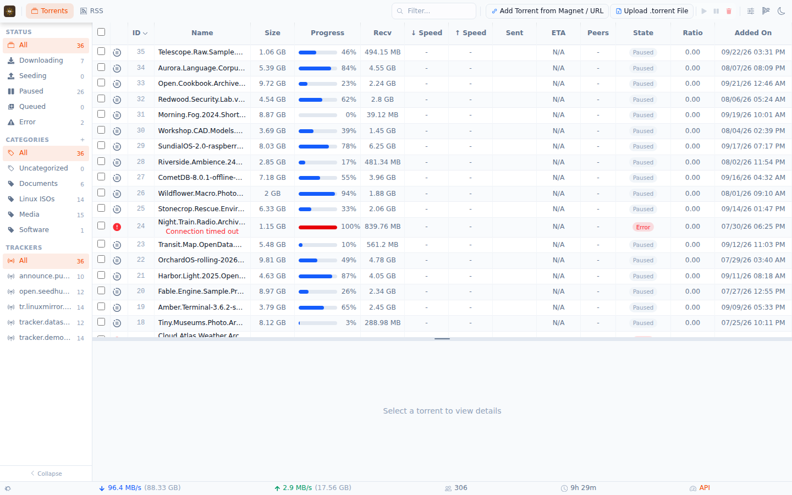

# rustTorrent

A modern, self-hostable BitTorrent client written in Rust — a single small binary with a
clean web UI, a full HTTP API, and qBittorrent-compatible endpoints for the tools you
already run.

> **Beta software.** rustTorrent is under active development. Expect bugs, breaking
> changes, and incomplete features. [Report issues](https://github.com/TheDancingDeveloper-org/rustTorrent/issues).

**Website:** [rusttorrent.dev](https://rusttorrent.dev/) ·
**Live demo:** [rusttorrent.dev/demo](https://rusttorrent.dev/demo/) ·
**Discord:** [discord.gg/pu6chSqpnJ](https://discord.gg/pu6chSqpnJ)



## Features

- **Web UI** — responsive React + TypeScript interface with a compact table view, detail
  panes, and dark mode. Works from any browser, desktop or mobile.
- **HTTP API** — everything the UI does is an API call: add torrents, query state, select
  files, stream content. Swagger documentation included.
- **qBittorrent-compatible API** — speaks the qBittorrent WebUI protocol, so Sonarr,
  Radarr, and other *arr applications connect without adapters.
- **Full peer discovery** — DHT, HTTP and UDP trackers, peer exchange, local service
  discovery, and UPnP port forwarding. Magnet links resolve metadata straight from the
  swarm.
- **Streaming** — play media files directly from incomplete torrents over HTTP.
- **RSS automation** — subscribe to feeds with filter rules and download new releases
  automatically.
- **Docker ready** — multi-stage build producing a minimal scratch-based image.
- **Desktop app** — native Tauri application for Windows, macOS, and Linux with system
  tray integration.
- **Native desktop client** — `rtbit-fluent`, a GPU-rendered client built on gpui with
  the Fluent design system, for managing a local or remote daemon. Linux `.deb` and
  binary ship with each release; the Windows desktop build is temporarily
  unavailable (WI-2779).
- **Memory safe** — written entirely in Rust; the bencode, DHT, and peer-protocol parsers
  are additionally fuzz-tested.

## Quick start

### Docker

```bash
docker run -d --name rusttorrent \
  -p 127.0.0.1:3030:3030 -p 4240:4240 \
  -v rtbit-db:/home/rtbit/db \
  -v rtbit-cache:/home/rtbit/cache \
  -v ~/downloads:/home/rtbit/downloads \
  -v ~/completed:/home/rtbit/completed \
  ghcr.io/thedancingdeveloper-org/rusttorrent:latest
```

Or build from the repository:

```bash
git clone https://github.com/TheDancingDeveloper-org/rustTorrent.git
cd rustTorrent
docker compose up --build -d
```

**Ports:** `3030` (web UI + API), `4240` (BitTorrent TCP + uTP). Publishing `3030`
without an address, as `-p 3030:3030` or the bundled compose file does, makes it
reachable from your whole network. Until the first-run setup is complete, anyone
who can reach that port can claim the setup, so finish setup before exposing it,
or keep it on `127.0.0.1` as in the command above.

**Volumes:** the image declares four volumes. Mount all of them to keep state
across container upgrades and removal.

| Container path | Contents |
|----------------|----------|
| `/home/rtbit/db` | Session, RSS, DHT and credential state (`XDG_DATA_HOME`). Back this up before upgrading. |
| `/home/rtbit/cache` | Cache data that can be rebuilt. |
| `/home/rtbit/downloads` | Default download folder for new torrents. |
| `/home/rtbit/completed` | Folder for completed torrents, when a completed folder is configured. |

**Image tags:** `latest` and `beta` both point at the most recent `v*` release tag,
and `<tag>` (for example `v0.1.0-rc.1`) is that release. Pin an exact tag when you
need reproducible deployments. Other tags are used for development:
`staging` tracks `main`, `dev` tracks the `dev` branch, and `sha-<commit>` is an
immutable build of one commit. Container images are published for `linux/amd64`
and `linux/arm64` for release tags only; `main` and `dev` builds are `linux/amd64`.

### Prebuilt binaries

Static binaries for Linux and Windows, with SHA256 checksums, are published at
[dl.rusttorrent.dev/latest](https://dl.rusttorrent.dev/latest/):

```bash
curl -LO https://dl.rusttorrent.dev/latest/rtbit-linux-x86_64
chmod +x rtbit-linux-x86_64
./rtbit-linux-x86_64 server start ~/Downloads
```

The web UI comes up at [http://localhost:3030](http://localhost:3030).

### From source

```bash
git clone https://github.com/TheDancingDeveloper-org/rustTorrent.git
cd rustTorrent
cargo build --release
./target/release/rtbit server start ~/Downloads
```

Requires a recent stable Rust (CI builds with 1.95) and Node.js/npm for the bundled web
UI. See [docs/TESTING.md](docs/TESTING.md) for running the test suites.

## Configuration

Most behaviour is configurable from the web UI's settings dialog or via CLI flags
(`rtbit --help`). The first browser visit walks through authentication setup.

## Repository layout

| Path | Contents |
|------|----------|
| `crates/rtbit` | CLI binary and server entry point |
| `crates/librtbit` | Core session, torrent state machine, storage, HTTP API, web UI |
| `crates/librtbit-*` | Protocol building blocks: bencode, DHT, peer protocol, trackers, UPnP, LSD |
| `crates/rtbit-fluent` | Native desktop client (gpui) |
| `crates/rtbit-ui-core`, `crates/rtbit-client` | Toolkit-free client state and the daemon API client it uses |
| `desktop/` | Tauri desktop application |
| `website/` | Static rusttorrent.dev website and deployment assets |
| `fuzz/` | Fuzz targets for the protocol parsers |
| `docs/` | Architecture notes, testing guide, fork provenance, release notes (`docs/releases/`) |

## CI

Pull requests run only the CI areas they touch; the merge queue runs the full
suite before anything reaches `main`. See [docs/ci.md](docs/ci.md).

## Naming

The project has several names, and they refer to different things:

- **rustTorrent** is the project, the repository and the container image
  (`rusttorrent`).
- **`rtbit`** is the command-line program (`rtbit server start …`) and the
  `crates/rtbit` package.
- **`librtbit`** is the core engine library, in `crates/librtbit`. It is published
  as the **`swarmforge`** package, so depend on `swarmforge` and import `librtbit`.
  The other `librtbit-*` directories are published as `swarmforge-*` packages.
- **rqbit** is the upstream project this repository forks. Its name appears only
  in attribution.

## Attribution

rustTorrent is a permanent hard fork of [rqbit](https://github.com/ikatson/rqbit) by
**Igor Katson**, licensed under Apache 2.0. The original copyright and license notices
are preserved; see [NOTICE](NOTICE) and [docs/FORK_PROVENANCE.md](docs/FORK_PROVENANCE.md)
for details of what was imported and when. We're grateful for Igor's work — rustTorrent
builds on that foundation.

## License

Apache 2.0 — see [LICENSE](LICENSE). Each path in the repository is described in
[docs/REPOSITORY-LAYOUT.md](docs/REPOSITORY-LAYOUT.md). Contribution guidelines are in
[CONTRIBUTING.md](CONTRIBUTING.md), the release history is in
[CHANGELOG.md](CHANGELOG.md), and security reports follow [SECURITY.md](SECURITY.md).
